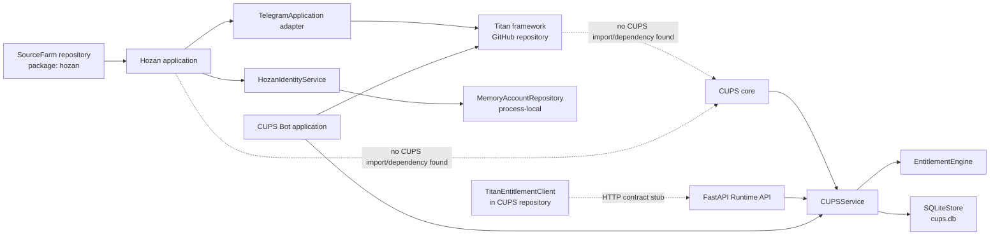

# خريطة الاعتماديات وتدفقات البيانات

**Snapshot:** 7 نوفمبر 2026؛ commit لكل مستودع موضح في `REPOSITORY_AUDIT.md`. هذه خريطة للعلاقات الموجودة فعلياً، وليست تصميمًا مستقبلياً.

## الرسم الفعلي



السهم المتقطع من `TitanEntitlementClient` يصف نموذجاً يرسل طلباً إلى object باسم `runtime`; لم أجد نشر API أو عميلاً في Titan يربطه فعلياً. لا يعني الرسم أن تكاملاً عاماً يعمل.

## اعتماديات التغليف الخارجية

| الحزمة | متطلبات manifest | اتجاه الاعتماد المثبت |
|---|---|---|
| SourceFarm repository / `hozan` | `titan-framework>=1.0.0b1`, Python `>=3.10` | تطبيق Hozan يعتمد Titan؛ عنوان الاعتماد لا يحدد Git URL، وPyPI أعاد 404 عند الفحص |
| Titan / `titan-framework` | `aiohttp>=3.9`, Python `>=3.10` | إطار مستقل؛ لا FastAPI/SQLite/CUPS dependency في manifest |
| CUPS core / `cups-platform` | `fastapi>=0.115`, `uvicorn[standard]>=0.30`, Python `>=3.10` | لا يعتمد على Titan في core |
| CUPS optional extra `bot` | `titan-framework @ git+https://github.com/WaheedFox/Titan.git` | تطبيق CUPS Bot يستهلك Titan؛ اعتماد اختياري للتطبيق لا CUPS core |
| CUPS optional extra `dev` | pytest, pytest-asyncio, httpx | أدوات اختبار |

`SourceFarm/pyproject.toml` يشير إلى `README.en.md` غير الموجود ضمن الملفات المتتبعة؛ وREADME في Titan يوصي بـ Git install. لم يُجر بناء SourceFarm package.

## حدود الوحدات واتجاهات الاستيراد

### Hozan داخل SourceFarm repository

```text
hozan.core.app.application
 ├─ hozan.core.lifecycle.runtime.Lifecycle
 ├─ hozan.features.identity.{HozanIdentityService, MemoryAccountRepository}
 ├─ hozan.features.registration.start.build_router
 └─ hozan.platform.telegram.application.TelegramApplication
       └─ titan.{Titan, Router}
```

- Composition root يختار `MemoryAccountRepository` مباشرة؛ Protocol موجود لكن لا يوجد implementation دائم.
- `/start` يستهلك identity service ويقرأ `ctx.user_id` و`ctx.sender.first_name` ثم يرد.
- `FeatureRegistry` غير مستخدم في composition الحالي.
- `TelegramApplication.start(lifecycle)` تتلقى `Lifecycle` لكنها لا تستخدمه لإدارة Titan؛ `stop` لا ينفذ إيقافاً خاصاً، ويملك Titan تشغيل polling عبر `run_async()`.
- لا توجد طبقة مشتركة تستخدمها SourceFarm/Hozan وCUPS.

### Titan

```text
Titan.run/run_async
 ├─ Telegram (aiohttp + Bot API)
 ├─ PollingRunner / lifecycle workers
 ├─ Update → Context → middleware → event/command routing
 ├─ Router + handlers
 ├─ TelegramAdapter (مجموعة wrappers)
 └─ نماذج مبسطة + privacy/links/health/inspection
```

النقل يحتفظ بـ token في Telegram client وينفذ POST JSON. `request(method, data)` مسار عام؛ لا توجد طبقة mapping كاملة لكل Telegram schema أو API method. `TelegramAdapter` يغطي مجموعة محدودة. Hozan يستخدم `Titan`, `Router`, و`ctx.reply()` في التطبيق الحالي.

### CUPS

```text
FastAPI Runtime API ─┐
                     ├─ CUPSService ─ EntitlementEngine + Catalogs ─ SQLiteStore
CUPS Bot (Titan) ────┘
```

- Runtime API ينشئ خدمة افتراضية عند import؛ `CUPSService` ينشئ `SQLiteStore()`، ومساره النسبي الافتراضي `cups.db`.
- `apps/cups-bot/main.py:40-43` يعلّق على مشاركة `cups.db`، كما ينشئ خدمة بالمسار الافتراضي. كلا المسارين نسبي إلى working directory؛ لا يثبت الكود أن عمليتي API والبوت تستخدمان الملف نفسه في deployment.
- اختبار Runtime يستورد module قبل fixture التي تستبدل الخدمة بـ SQLite in-memory؛ استيراد module قد يفتح/ينشئ `cups.db` قبل تشغيل الاختبار. لم أعد تشغيل الاختبارات في جولة الاستكمال كي لا أكتب إلى قاعدة بيانات.
- SQLite تستخدم parameterized placeholders، وconnection واحدة لكل `SQLiteStore` مع `check_same_thread=False`; توجد معاملات `BEGIN IMMEDIATE` لعمليات الحجز/الاستهلاك. هذه ملاحظة على المسارات التي راجعتها وليست تدقيقاً لكل SQL.
- حالة `/addbot` تحفظ في `_pending` داخل ذاكرة process، لا SQLite.
- CUPS catalogs يحددان `titan-framework` و`cups-bot`; اختيار `/addbot` الفعلي يعرض `titan-framework` فقط.

## التبعية والتكامل بين المستودعات

| الزوج | ما وجدته في الشيفرة | الاستنتاج المسموح |
|---|---|---|
| SourceFarm → Titan | dependency في `pyproject.toml` واستيراد `Titan, Router` في Hozan | اعتماد تطبيق/Runtime مباشر |
| CUPS Bot → Titan | استيراد Titan في `apps/cups-bot/` وextra `bot` يشير إلى Git repo | Titan إطار تشغيل بوت CUPS |
| CUPS core → Titan | لا import في `src/cups` ولا dependency تشغيل في manifest | نواة CUPS مستقلة |
| Titan → CUPS | لا import/dependency لـ CUPS أو `titan-extension-cups` | ما تصفه بعض وثائق CUPS تصور/مستقبل، لا اعتماد حزمة فعلي |
| SourceFarm/Hozan → CUPS | لا import أو client أو API configuration | لا تكامل مثبت |
| CUPS → SourceFarm/Hozan | Catalog لـ `titan-framework` و`cups-bot` فقط | لا توجد Entitlements لهذه المنتجات |

`CUPS/apps/titan_framework/cups_client.py` يعرّف `TitanEntitlementClient` داخل CUPS، لا Titan. يرسل `account_id`, `project_id`, `entitlement` إلى `runtime.post(...)`؛ لا يضيف API key رغم أن وثائق CUPS تعرض مثال `CUPSGuard(api_key=...)`. لا يستورده Titan أو SourceFarm.

## تدفقات البيانات الفعلية

### تسجيل حساب Hozan

```text
Telegram Update → Titan Polling → Router /start
→ HozanIdentityService.get_or_create_account
→ MemoryAccountRepository
→ إنشاء Hozan ID #NNNNNNNN
→ ctx.reply()
```

البيانات تبقى في الذاكرة ولا تملك storage contract دائم. لا يظهر في التطبيق سوى `HOZAN_TOKEN` لتشغيل بوت المنصة؛ لا توجد إدارة رموز بوتات المستخدمين.

### CUPS entitlement check

```text
HTTP JSON: account_id + project_id + entitlement
→ FastAPI route
→ CUPSService.check_entitlement
→ مقارنة owner + subscription/catalog resolution
→ {granted, value}
```

`account_id` جزء من JSON، لا هوية موثقة من credential. لم أجد dependency للمصادقة في routes التي راجعتها؛ اختبارات TestClient تعمل بلا ترويسة Authorization. هذا يثبت سلوك الكود والاختبار فقط. التعرض الخارجي وحدود الشبكة `NOT VERIFIED`.

### CUPS resource accounting

```text
HTTP JSON request → CUPSService quota/reserve/consume
→ project owner check + resource limit resolution
→ SQLite transaction/idempotency key
→ reservation/consumption result
```

المورد المدعوم في `_resource_limit` حالياً هو `projects`; البنية أوسع من التنفيذ. توجد idempotency وعمليات SQLite atomic، لكن ذلك لا يصادق caller.

## نقاط الاقتران والمخاطر المثبتة

- حزمة SourceFarm تعتمد اسم توزيع غير متاح حالياً في PyPI؛ CUPS optional bot extra يشير إلى Git مباشرة.
- اسم repository/application غير متسق: مستودع SourceFarm يحزم `hozan` وmetadata تشير إلى Hozan repo مستقل لم أجده عاماً.
- Hozan يستخدم Titan، وأمر `/link` محجوز في Titan، فيتعارض مع دلالة مشاركة رابط المنتج.
- وثائق CUPS تقترح API-key client، لكن API لا يتطلبه والعميل لا يرسله؛ `account_id` في JSON لا يثبت هوية المرسل.
- `cups.db` مسار نسبي؛ استيراد Runtime قد يفتحه قبل fixture الاختبار، ولا توجد إعدادات نشر موثقة لتأكيد مشاركة الملف بين عمليات API والبوت.
- SQLite وmemory identity ليسا تخزيناً مشتركاً بين المنتجات؛ لا يوجد Shared Core/Storage حالي مثبت.
- `setMyCommands` wrapper متوفر في Titan فقط، ولا يستعمله تطبيق Hozan. لا يوجد تسجيل/تغيير تلقائي لقائمة BotFather في SourceFarm.

## مراجع الشيفرة للادعاءات المهمة

الأسماء ونطاقات الأسطر التالية تخص public snapshots المثبتة في `REPOSITORY_AUDIT.md`، ولا تثبت حالة محلية غير مرفوعة.

| الادعاء | الملف | الرمز | نطاق الأسطر |
|---|---|---|---|
| Hozan يركّب repository ذاكرية وRouter البداية | `SourceFarm/src/hozan/core/app/application.py` | `Hozan.__init__` | 9-20 |
| `/start` هو المعالج الظاهر ويرشح `/assets`, `/settings` في الرد | `SourceFarm/src/hozan/features/registration/start.py` | `build_router` | 8-29 |
| الهوية محفوظة في قاموسين داخل الذاكرة | `SourceFarm/src/hozan/features/identity/memory.py` | `MemoryAccountRepository` | 6-36 |
| Titan يرسل JSON عبر transport عام | `Titan/src/titan/telegram.py` | `Telegram.request` | 50-89 |
| Titan يحجز `/link` ويرفض تعارض التسجيل | `Titan/src/titan/bot.py` | `_register_link_command`; `Router.command` | 315-337; 381-401 |
| dispatch يمرر Update types محددة | `Titan/src/titan/bot.py` | `_handle_update` | 656-739 |
| Runtime API يبني الخدمة الافتراضية ويقرأ هوية body | `CUPS/src/cups/api/runtime.py` | `_service`; request models; route handlers | 25-32; 37-89; 103-146; 171-226 |
| اختبار API يستخدم خدمة in-memory بعد استيراد module | `CUPS/tests/api/test_runtime.py` | module import; test fixture | 12; 18-25 |
| ملكية المشروع تقارن بمعرّف caller المرسل | `CUPS/src/cups/service.py` | `_owned_project` | 239-245 |
| SQLite الافتراضية relative path والمعاملات | `CUPS/src/cups/storage/sqlite.py` | `SQLiteStore.__init__`; resource queries | 181-188; 240-370 |
| نية مشاركة DB في عملية bot لا تثبت مسار النشر | `CUPS/apps/cups-bot/main.py` | CUPS service construction/comment | 40-43 |
| client لا يرسل API key | `CUPS/apps/titan_framework/cups_client.py` | `TitanEntitlementClient` | 6-33 |
| الدفع مُمثّل ومحاكاة | `CUPS/src/cups/service.py` | test subscription/payment methods | 261-277; 326-383 |

## توصيات خريطة الاعتماديات — غير معتمدة

1. حافظ على اتجاه `Hozan/SourceFarm application → Titan runtime` ما دام يوفر النقل والـ lifecycle؛ افصل Action Registry كطبقة منتج ولا تساوِ Telegram API الخام بمحرر المستخدم.
2. أبقِ CUPS مستقلاً إلى أن يثبت consumer حقيقي ويُعتمد عقد API مصادق عليه.
3. لا تجعل CUPS core يعتمد Titan؛ اتجاه bot كـ consumer أبسط وأقل coupling.
4. لا تشارك identity/DB/secrets بين SourceFarm وHozan أو CUPS بسبب تشابه أسماء أو وثائق؛ لا يوجد تدفق فعلي يبرر ذلك.
5. وحّد مصدر تثبيت Titan للمستودعات بعد اختيار إصدار/commit موثق؛ لا تغيير dependency ضمن هذا التدقيق.

## مصادر الشيفرة

- [SourceFarm pyproject](https://github.com/WaheedFox/SourceFarm/blob/2187dfd29f8b1ce9fc45ba53acc61b091898cb44/pyproject.toml)
- [Hozan composition root](https://github.com/WaheedFox/SourceFarm/blob/2187dfd29f8b1ce9fc45ba53acc61b091898cb44/src/hozan/core/app/application.py)
- [Titan Telegram transport](https://github.com/WaheedFox/Titan/blob/b00b43ecee5c3b7d6cc06467b07c4418d467521b/src/titan/telegram.py)
- [Titan adapter](https://github.com/WaheedFox/Titan/blob/b00b43ecee5c3b7d6cc06467b07c4418d467521b/src/titan/adapter.py)
- [CUPS pyproject](https://github.com/WaheedFox/CUPS/blob/565650cd55c0d92bdae2f99fe44b48f51a63c527/pyproject.toml)
- [CUPS Runtime API](https://github.com/WaheedFox/CUPS/blob/565650cd55c0d92bdae2f99fe44b48f51a63c527/src/cups/api/runtime.py)
- [CUPS Titan client](https://github.com/WaheedFox/CUPS/blob/565650cd55c0d92bdae2f99fe44b48f51a63c527/apps/titan_framework/cups_client.py)
